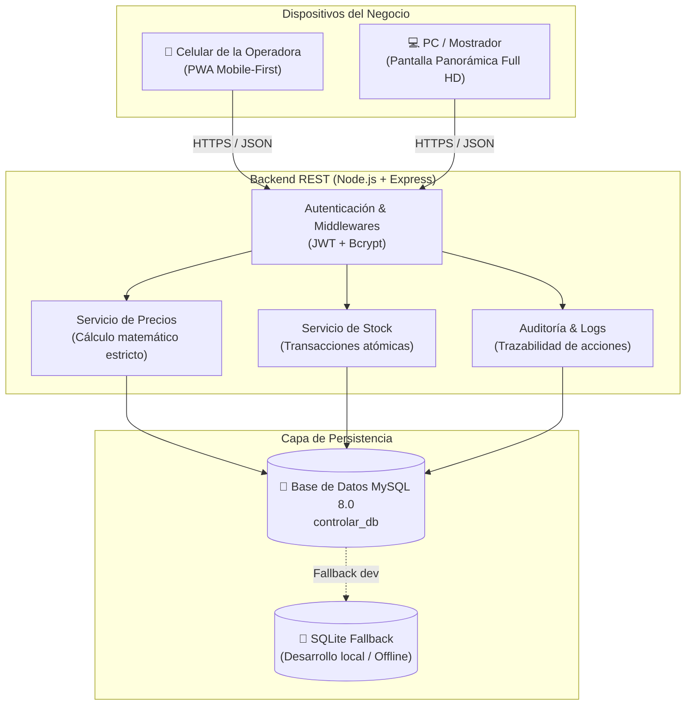

# ControlAR

> **Sistema Integral de Gestión Comercial, Control de Stock y Precios de Góndola**  
> Diseñado a medida para **Victoria Productos Artesanales**

[](https://developer.mozilla.org/es/docs/Web/Progressive_web_apps)
[](https://nodejs.org/)
[](https://react.dev/)
[](https://www.mysql.com/)
[](https://jwt.io/)

---

## 📖 ¿De qué trata ControlAR?

**ControlAR** es una solución de gestión comercial concebida específicamente para **despensas, comercios de cercanía y negocios familiares** que necesitan controlar su mercadería, sus costos y sus precios de venta de manera rápida, confiable y sin complicaciones técnicas.

El sistema nació para resolver las necesidades operativas de **Victoria Productos Artesanales**, un negocio donde la administración diaria se realiza de forma directa en el mostrador o recorriendo las góndolas mediante un teléfono celular.

### 🎯 Propósito central: ¿Qué preguntas responde al instante?

1. **¿Qué productos tengo en catálogo?** — Búsqueda instantánea y ficha completa de cada artículo.
2. **¿Cuánto stock físico hay disponible?** — Información en tiempo real con unidades de medida reales (unidades, gramos, kilos, litros).
3. **¿Qué mercadería requiere compra urgente?** — Semáforo de estados para reponer a tiempo y evitar pérdidas de ventas.
4. **¿Qué productos están completamente agotados?** — Alertas visuales inmediatas.
5. **¿Cuál es el costo real y qué margen de ganancia deja cada producto?** — Claridad absoluta en la rentabilidad de cada ítem.
6. **¿A qué precio debo vender en mostrador?** — Cálculo automático y transparente de precios de góndola, eliminando cuentas a mano y errores humanos.

---

## 💡 Filosofía y Principios de Diseño

* **Mobile-First real (PWA):** Funciona e instala como una app nativa en el celular (Android / iOS) con navegación al alcance del pulgar, pero se expande con ergonomía en pantallas de mostrador y monitores panorámicos (Full HD).
* **Simplicidad sin fricción:** Diseñado para personas sin formación técnica. Tipografías legibles, botones táctiles generosos, formularios paso a paso y lenguaje directo sin jerga innecesaria.
* **El backend como única fuente de verdad:** Ningún cálculo crítico (fórmulas de precios, márgenes ni descuentos de stock) se confía al navegador. La API valida y procesa todo con rigor matemático y transaccional.
* **Integridad inmutable de stock:** Prohibido alterar el stock "tipeando encima". Todo cambio de inventario proviene de una acción concreta: una **Entrada**, una **Salida** o un **Ajuste** justificado.

---

## 🚀 Funcionalidades Principales

### 1. 🧮 Regla Oficial de Fijación de Precios
El precio de mostrador se calcula mediante una regla comercial directa y transparente basada en el costo real:

$$\text{Precio de mostrador} = \text{Costo real} \times \left(1 + \frac{\text{Porcentaje de Ganancia}}{100}\right)$$

* **Simulador en vivo:** Al cargar o modificar costos o porcentajes, el sistema proyecta en pantalla el precio resultante en tiempo real.
* **Margen persistente por producto:** Cada artículo conserva su propio porcentaje de recargo comercial.
* **Asistente de Fraccionados:** Resuelve el dilema de mercaderías que se compran por bulto/paquete y se venden al peso o volumen (ej: frutos secos, harinas, especias, quesos). El asistente calcula el costo por gramo/mililitro y determina el precio fraccionado correspondiente.

### 2. 📦 Control de Inventario Atómico y Trazabilidad
Para evitar diferencias de inventario inexplicables, ControlAR maneja 3 operaciones atómicas:
* ➕ **ENTRADA:** Ingreso por compra a proveedores o elaboración propia.
* ➖ **SALIDA:** Venta o retiro de mostrador (con validación estricta: **nunca se permite stock negativo**).
* ⚖️ **AJUSTE:** Corrección por conteo físico de góndola, vencimiento o rotura.

Cada movimiento registra automáticamente: **operador responsable, tipo de operación, cantidad, stock anterior, stock resultante, motivo y fecha/hora exacta**.

### 3. 🚦 Semáforo Dinámico de Reposición
El inventario se clasifica visualmente de forma automática:
* 🔴 **AGOTADO:** Stock en cero.
* 🟡 **REPONER:** Stock menor o igual al umbral mínimo establecido para el producto.
* 🟢 **DISPONIBLE:** Mercadería suficiente en góndola/depósito.

Incluye una pantalla dedicada de **Reposición Rápida** para asentar ingresos de mercadería con un solo toque sin ingresar a cada ficha individual.

### 4. 🔐 Seguridad y Perfiles de Acceso (Sin Registro Abierto)
* **Acceso por DNI y PIN:** Rápido de teclear en pantalla táctil de celular.
* **Criptografía segura:** PINs almacenados exclusivamente como hashes con `bcrypt` (10 rondas de salt). Nunca viajan ni se guardan en texto claro.
* **Sesiones JWT:** Tokens firmados de corta duración.
* **Roles:**
  * **`USUARIO`:** Operación cotidiana: consultas, carga de productos, entradas/salidas/ajustes de stock, reposición y cambio de PIN personal.
  * **`SUPER_ADMIN`:** Acceso total: creación y administración de usuarios, reseteo de claves, categorías comerciales, logs de auditoría y diagnóstico de salud del servidor/base de datos.

---

## 🏗️ Arquitectura Técnica



### Stack Tecnológico

| Capa | Tecnologías | Propósito |
| :--- | :--- | :--- |
| **Frontend** | React 18, Vite, CSS moderno, Service Workers | Experiencia PWA ultra fluida, rápida y responsiva |
| **Backend** | Node.js, Express.js | API REST modular, segura y liviana |
| **Persistencia** | MySQL 8.0 (con SQLite embebido de soporte) | Integridad referencial y transacciones atómicas |
| **Seguridad** | JWT, bcryptjs, CORS, Helmet | Protección de credenciales y rutas |
| **Deploy** | Vercel (Frontend) + Railway (Backend y MySQL) | Infraestructura serverless de alta disponibilidad |

---

## 📂 Estructura del Repositorio

```text
ControlARsistema/
├── backend/                      # API REST en Node.js + Express
│   ├── src/
│   │   ├── config/               # Conexión DB (MySQL con auto-init y fallback SQLite)
│   │   ├── controllers/          # Controladores (auth, productos, stock, categorias, etc.)
│   │   ├── routes/               # Rutas de endpoints REST
│   │   ├── middleware/           # Autenticación JWT, control de roles y manejo de errores
│   │   ├── services/             # Reglas de negocio (precioService, stockService, etc.)
│   │   └── server.js             # Punto de entrada del servidor
│   ├── schema.sql                # Estructura DDL de base de datos y datos iniciales
│   └── package.json
│
├── frontend/                     # Aplicación cliente React + Vite (PWA)
│   ├── src/
│   │   ├── components/           # Componentes UI (ProductCard, StockBadge, Modales, etc.)
│   │   ├── pages/                # Pantallas (Inicio, Productos, Detalle, Reponer, Admin, etc.)
│   │   ├── context/              # Contexto global de autenticación y estado
│   │   └── utils/                # Formateadores de moneda ($ ARS) y unidades
│   ├── public/                   # Manifiesto PWA e íconos para instalación
│   └── package.json
│
└── docs/                         # Documentación funcional y técnica detallada
    ├── controlar.md              # Especificación técnica oficial del MVP
    ├── funcionamiento_del_sistema.md  # Manual de arquitectura y flujo operativo
    └── ROADMAP.md                # Planes de expansión y versiones futuras
```

---

## ⚡ Instalación y Puesta en Marcha Local

### Prerrequisitos
* **Node.js** (versión 18 o superior)
* **npm** (incluido con Node.js)
* **MySQL** *(opcional para desarrollo local; si no está activo, el backend utiliza automáticamente la base local SQLite de pruebas)*.

### 1. Clonar el repositorio
```bash
git clone https://github.com/tu-usuario/ControlAR.git
cd ControlAR/ControlARsistema
```

### 2. Iniciar el Backend
```bash
cd backend
npm install
npm start
```
> El servidor iniciará en: `http://localhost:3001/api`

### 3. Iniciar el Frontend
En otra ventana de la terminal:
```bash
cd frontend
npm install
npm run dev
```
> La aplicación estará disponible en: `http://localhost:5173`

---

## 🔑 Credencial de Acceso Inicial (Administrador)

Para el primer ingreso en entornos de desarrollo o demostración:

| Rol | DNI | PIN inicial |
| :--- | :--- | :--- |
| **`SUPER_ADMIN`** (Administrador) | `47115449` | `1234` |

> *Los usuarios regulares (`USUARIO`) se crean de manera interna desde el **Panel de Administración > Usuarios**.*

---

## 📚 Documentación de Referencia

Para conocer en profundidad la arquitectura, las fórmulas matemáticas o la visión a futuro del sistema, consulta los documentos de la carpeta `docs/`:
* [📘 Guía de Funcionamiento y Arquitectura](docs/funcionamiento_del_sistema.md)
* [📋 Especificación Funcional Original](docs/controlar.md)
* [🗺️ Hoja de Ruta y Roadmap](docs/ROADMAP.md)

---

<p align="center">
  <b>ControlAR</b> — Desarrollado con ❤️ para <b>Victoria Productos Artesanales</b> (2026)
</p>
